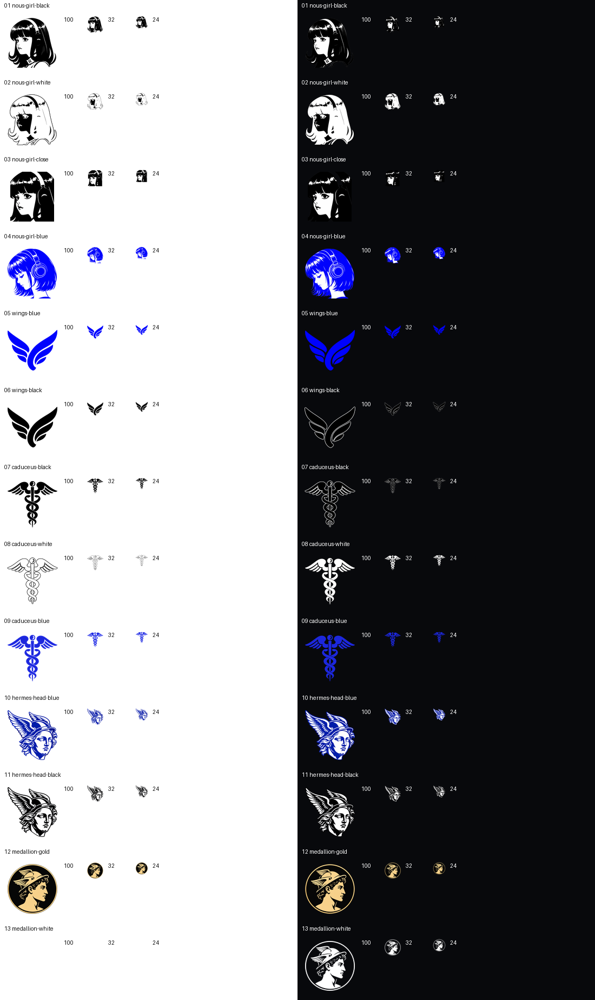

# Hermes Community Icons
An unofficial collection of Telegram custom emoji and Windows shortcut icons, inspired by Hermes / Nous and classical imagery. See [NOTICE.md](NOTICE.md).
13 designs in two formats: transparent 100 × 100 PNGs for Telegram and multi-resolution ICOs for Windows shortcuts.

## Quick start
- **Telegram:** [Add Hermes Community Icons](https://t.me/addemoji/HermesCommunityIcons)

## Source
- **ICO:** [Download all 13 ICOs](dist/hermes-windows-icons.zip?raw=true) and extract them to a permanent folder. Right-click a shortcut, open **Properties → Shortcut → Change Icon → Browse**, select an `.ico` file, then confirm with **OK → Apply**. Keep the ICO files in that folder. See [sizes and SHA-256 hashes](windows-manifest.json).
- **PNG:** [Download all 13 PNGs](dist/hermes-telegram-emoji.zip?raw=true) to create your own emoji set. See [Create your own set from the PNGs](#create-your-own-set-from-the-pngs) and the [proposed emoji mappings](manifest.json).

## Preview

The PNGs have fixed colours; they are not adaptive emoji. Small details and thin outlines may appear softer at 24 pixels.

## Use in Telegram
The set is published as **Hermes [Community Icons]**. Open the link above to add it in Telegram.

## Create your own set from the PNGs
1. Download and extract the ZIP, then open the official [@Stickers Mini App](https://t.me/stickers?startapp) in Telegram.
2. Start creating a new **custom emoji** set and select the static image format. Choose emoji, not a regular sticker pack: these icons are 100 × 100 pixels, not 512-pixel stickers.
3. Upload the PNG files as files/originals without resizing or conversion. Follow the Mini App's prompts for the set name and emoji associations; use `proposed_emoji` in the manifest as a starting point, not as a required mapping.
4. Preview a trial image on light and dark themes and in a real message before completing your set.

Telegram states that anyone can create custom emoji, while adding and using custom sets generally requires Telegram Premium; free-emoji exceptions and account/client rules may apply. Check the current [official requirements](https://core.telegram.org/stickers#custom-emoji) and [custom emoji documentation](https://core.telegram.org/api/custom-emoji).

No blanket licence to third-party artwork or marks is granted. This repository does not assert ownership of that material.
